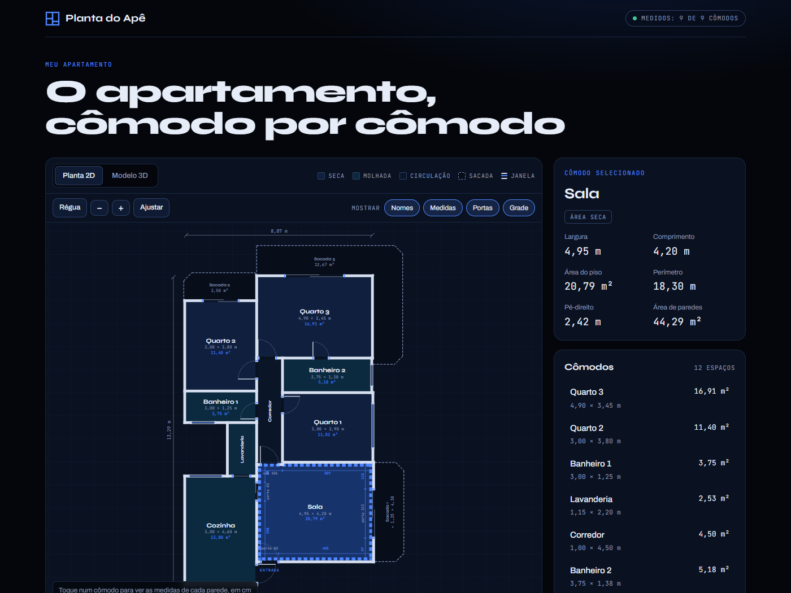
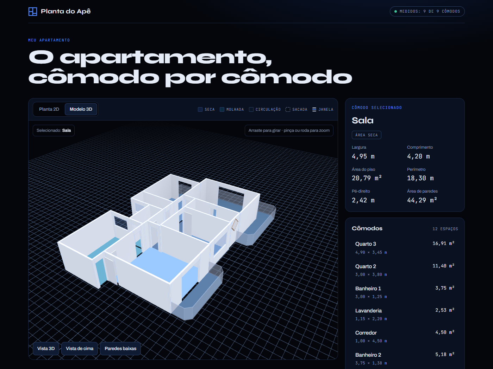
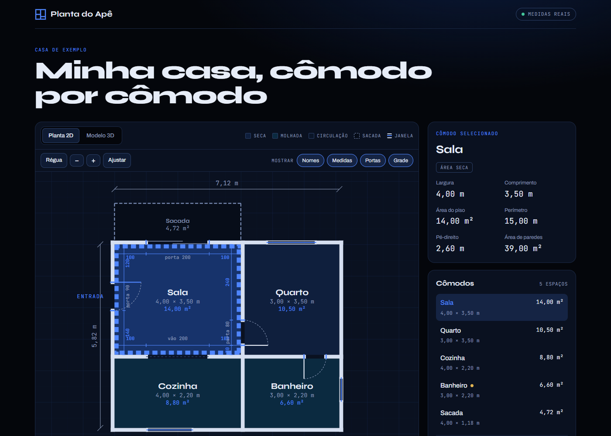

<div align="center">

# 🏠 Planta do Apê

**Transforme as medidas da sua casa numa planta baixa interativa e num modelo 3D, direto no navegador.**

Um projeto pessoal construído **inteiramente com IA**: eu dirigi as ideias, as medidas e as decisões, e a IA escreveu o código.
Comecei com o meu apartamento e deixei tudo pronto para **qualquer pessoa desenhar a própria casa**.


<!-- Quando publicar, troque pelo link do site: -->
<!-- [**🔗 Ver ao vivo**](https://SEU-PROJETO.web.app) -->

</div>

---





## Sumário

- [O que dá pra fazer](#-o-que-dá-pra-fazer)
- [Feito com IA](#-feito-com-ia)
- [Faça a planta da sua casa](#-faça-a-planta-da-sua-casa)
  - [1. Baixe e rode o projeto](#1-baixe-e-rode-o-projeto)
  - [2. Meça a casa](#2-meça-a-casa)
  - [3. Entenda as coordenadas](#3-entenda-as-coordenadas)
  - [4. Comece pela casa de exemplo](#4-comece-pela-casa-de-exemplo)
  - [5. Cômodos](#5-cômodos)
  - [6. Portas](#6-portas)
  - [7. Janelas](#7-janelas)
  - [8. Sacadas e formas livres](#8-sacadas-e-formas-livres)
  - [9. Publique](#9-publique)
  - [Dicas e erros comuns](#dicas-e-erros-comuns)
  - [Referência de campos](#referência-de-campos)
- [Tecnologias e arquitetura](#-tecnologias-e-arquitetura)
- [Licença](#-licença)

## ✨ O que dá pra fazer

- **Planta 2D interativa em SVG**: zoom (roda do mouse, botões ou pinça no celular), arrastar e enquadrar.
- **Clique num cômodo** para ver largura, comprimento, área do piso, perímetro, pé-direito e área de paredes.
- **Medida de cada parede**, em cm, com portas, vãos e janelas descontados.
- **Régua** para medir a distância entre dois pontos quaisquer.
- **Coordenadas sob o cursor**, que ajudam a posicionar portas e janelas na hora de montar a sua planta.
- **Camadas** liga/desliga: nomes, cotas, portas e grade.
- **Modelo 3D** gerado dos mesmos dados: paredes, portas abertas, janelas com vidro, sacadas com guarda-corpo, vista de cima e o modo "paredes baixas".
- **Mensagens de erro claras** quando algum dado está errado, inclusive uma vírgula faltando.
- Funciona no **celular** e é acessível pelo **teclado**.

## 🤖 Feito com IA

Este projeto é um experimento sobre **até onde dá pra ir construindo software só conversando com uma IA**.

- Eu não escrevi o código à mão: descrevi o que queria, passei as medidas tiradas com trena e validei cada resultado.
- A IA (Claude) escreveu a geometria (paredes, recortes de portas e janelas, guarda-corpos), o desenho em SVG, a interação por toque e o modelo 3D.
- A organização em módulos e a transformação em ferramenta reutilizável também foram feitas com IA.

A ideia é mostrar o potencial da IA como parceira de desenvolvimento: dá pra sair de um rascunho no papel e chegar numa aplicação organizada, funcional e que outras pessoas podem usar.

---

## 📐 Faça a planta da sua casa

Você só vai editar **um arquivo**: [`public/js/constants/apartamento.js`](public/js/constants/apartamento.js). A planta 2D, o modelo 3D, as áreas e a lista de cômodos são gerados automaticamente a partir dele.

### 1. Baixe e rode o projeto

Você precisa do [Node.js](https://nodejs.org/) instalado (só para rodar um servidor local).

```bash
git clone https://github.com/porcherm/planta-casa.git
cd planta-casa
npm run dev
```

Abra **http://localhost:5000**. A cada alteração no arquivo de dados, é só salvar e recarregar a página (F5).

> ⚠️ Abrir o `index.html` com dois cliques **não funciona**, porque o navegador bloqueia módulos JavaScript fora de um servidor. Use sempre o `npm run dev`.

### 2. Meça a casa

Com uma trena, anote para cada cômodo:

- **largura** (esquerda → direita) e **comprimento** (cima → baixo), **de parede a parede, por dentro**;
- a **espessura das paredes** internas (normalmente entre 12 e 15 cm; meça no batente de uma porta);
- a posição e a largura de cada **porta** e **janela**;
- o **pé-direito** (altura do chão ao teto).

Antes de passar para o computador, faça um **rascunho no papel** com os cômodos na posição certa. Isso ajuda muito.

### 3. Entenda as coordenadas

A planta é como uma folha quadriculada onde **1 unidade = 1 cm**:

```
 (0,0) ──────────► x  (cresce para a direita)
   │
   │    ┌──────────┐
   │    │  cômodo  │   x, y = canto de cima à esquerda
   │    └──────────┘
   ▼
   y  (cresce para BAIXO)
```

Três regras resolvem quase tudo:

| Regra | Exemplo (parede de 12 cm) |
|---|---|
| **Cômodo vizinho à direita**: `x` = `x` do anterior + `largura` + `parede` | `0 + 400 + 12 = 412` |
| **Cômodo vizinho abaixo**: `y` = `y` do anterior + `comprimento` + `parede` | `0 + 350 + 12 = 362` |
| **Portas e janelas ficam no meio da parede** (no eixo): borda do cômodo + `parede / 2` | `400 + 6 = 406` |

> 💡 **Dica:** com o site aberto, **passe o mouse sobre a planta**. O canto superior direito mostra as coordenadas `x` e `y` do ponto. Use isso para descobrir onde colocar uma porta ou janela.

### 4. Comece pela casa de exemplo

Existe uma casa bem simples, comentada linha a linha, em [`public/js/constants/exemplos/casa-simples.js`](public/js/constants/exemplos/casa-simples.js):



1. Copie todo o conteúdo dela para `public/js/constants/apartamento.js`, substituindo o que está lá.
2. Recarregue a página: você vai ver a casa de exemplo.
3. Vá trocando cômodo por cômodo pelas medidas da sua casa, recarregando a cada passo.

No topo do arquivo ficam as informações gerais:

```js
export const APARTAMENTO = {
  nome: 'Casa da Maria',                      // aparece acima do título
  titulo: 'Minha casa, cômodo por cômodo',    // título grande da página
  estado: 'real',                             // 'real', 'rascunho' ou 'exemplo'
  comodoInicial: 'sala',                      // id do cômodo já selecionado ao abrir
  peDireito: 260,                             // altura do teto (cm)
  parede: 12,                                 // espessura das paredes internas (cm)
  alturaPorta: 210,                           // altura das portas (cm)
  comodos: [ /* ... */ ],
  portas: [ /* ... */ ],
  janelas: [ /* ... */ ],
};
```

### 5. Cômodos

Cada cômodo retangular é uma linha:

```js
{ id: 'sala', nome: 'Sala', tipo: 'seco', medido: true, x: 0, y: 0, largura: 400, comprimento: 350 },
{ id: 'quarto', nome: 'Quarto', tipo: 'seco', medido: true, x: 412, y: 0, largura: 300, comprimento: 350 },
```

- `id`: um nome curto, sem espaços e sem acento (usado internamente).
- `tipo`: define a cor. `seco` (sala, quartos), `molhado` (cozinha, banheiro, lavanderia), `circulacao` (corredores), `sacada` ou `indefinido` (ainda não sabe).
- `medido: true`: marca que você mediu com trena. O selo no topo da página mostra quantos cômodos já foram medidos.
- `nota` (opcional): um aviso que aparece ao selecionar o cômodo, por exemplo `nota: 'Confirmar a largura'`.

As paredes são **desenhadas automaticamente** em volta de cada cômodo; você não precisa declará-las.

### 6. Portas

A porta é um segmento **no eixo da parede**, de `(x1, y1)` até `(x2, y2)`. Ela precisa ser reta: horizontal (mesmo `y`) ou vertical (mesmo `x`).

```js
// Porta vertical na parede entre Sala e Quarto (eixo em x = 406), com 80 cm de largura
{ nome: 'Quarto', tipo: 'porta', x1: 406, y1: 240, x2: 406, y2: 320, lado: 1, dobradica: 'fim' },
```

| `tipo` | O que é |
|---|---|
| `porta` | porta comum, de abrir |
| `entrada` | porta de entrada (destacada em azul, com o texto "ENTRADA") |
| `correr` | porta de correr |
| `vao` | passagem aberta, sem porta |

Para portas de abrir (`porta` e `entrada`):

- `lado` indica **para onde a porta abre**: numa porta vertical, `1` = direita e `-1` = esquerda; numa porta horizontal, `1` = para baixo e `-1` = para cima.
- `dobradica` indica **em qual ponta fica a dobradiça**: `'inicio'` = no ponto `(x1, y1)`, `'fim'` = no ponto `(x2, y2)`.

Errou o lado? Troque `1` por `-1` e recarregue. É mais rápido testar do que pensar 😉

### 7. Janelas

Igual às portas (segmento no eixo da parede), mais as alturas:

```js
{ nome: 'Janela da Cozinha', x1: 100, y1: 588, x2: 250, y2: 588, peitoril: 110, topo: 210 },
```

- `peitoril`: altura do chão até a base da janela (cm).
- `topo`: altura do chão até o topo da janela (cm).
- `forma: 'losango'` (opcional): janela quadrada girada 45°, comum em banheiros.

### 8. Sacadas e formas livres

Para formatos que não são retângulos, use `pontos`: a lista dos cantos em ordem, como se você contornasse o cômodo com o dedo.

```js
{ id: 'sacada', nome: 'Sacada', tipo: 'sacada', pontos: [[0, -12], [400, -12], [400, -130], [0, -130]] },
```

- Cômodos do tipo `sacada` não ganham paredes: ganham **guarda-corpo** (a linha tracejada), exceto no lado que encosta na casa.
- Para encostar a sacada na casa, use a **face de fora da parede**: borda do cômodo + `parede` inteira. No exemplo, a parede de cima da sala fica em `y = -6` (eixo) e a face de fora em `y = -12`.
- Se o nome ficar em lugar ruim, ajuste a posição com `rotulo: [x, y]`.

### 9. Publique

O projeto já vem configurado para o **Firebase Hosting** (gratuito):

```bash
npm install -g firebase-tools
firebase login
firebase use --add        # escolha um projeto criado em console.firebase.google.com
npm run deploy
```

No fim, o terminal mostra o link do seu site (algo como `https://seu-projeto.web.app`).

> Como é um site estático, também funciona na **Netlify** ou na **Vercel**: é só indicar `public/` como pasta de publicação.

### Dicas e erros comuns

- **A página mostra "Erro nos dados da planta"**: leia a mensagem, porque ela diz qual cômodo e qual campo estão errados. Se o erro for "de escrita", procure uma **vírgula**, **chave `{ }`** ou **colchete `[ ]`** faltando perto da linha que você editou por último.
- **A porta aparece, mas a parede não abriu no lugar dela**: a porta não está exatamente no eixo da parede. Confira a conta `borda + parede / 2`.
- **Dois cômodos estão grudados, sem parede entre eles**: faltou somar a `parede` no `x` ou no `y` do segundo cômodo.
- **Cômodo em formato de L**: use `pontos`, ou divida em dois retângulos.
- **Meça duas vezes**: a régua do site ajuda a conferir se as medidas fecham.

### Referência de campos

<details>
<summary><b>Geral</b></summary>

| Campo | Obrigatório | Padrão | Descrição |
|---|---|---|---|
| `nome` | não | `'Minha casa'` | Nome exibido acima do título e na aba do navegador |
| `titulo` | não | `'Minha casa, cômodo por cômodo'` | Título grande da página |
| `estado` | não | `'real'` | `'real'`, `'rascunho'` ou `'exemplo'` (texto do selo no topo) |
| `comodoInicial` | não | primeiro cômodo | `id` do cômodo selecionado ao abrir |
| `peDireito` | não | `260` | Altura do teto, em cm |
| `parede` | não | `0` | Espessura das paredes internas, em cm |
| `alturaPorta` | não | `210` | Altura das portas, em cm |
| `comodos` | **sim** | | Lista de cômodos (pelo menos um) |
| `portas` | não | `[]` | Lista de portas |
| `janelas` | não | `[]` | Lista de janelas |

</details>

<details>
<summary><b>Cômodo</b></summary>

| Campo | Obrigatório | Descrição |
|---|---|---|
| `nome` | **sim** | Nome exibido |
| `id` | não | Identificador sem espaços (gerado se faltar) |
| `tipo` | não | `seco` (padrão), `molhado`, `circulacao`, `sacada` ou `indefinido` |
| `x`, `y`, `largura`, `comprimento` | **sim**, se não usar `pontos` | Retângulo, em cm |
| `pontos` | **sim**, se não usar o retângulo | Lista de cantos `[x, y]` (mínimo 3) |
| `medido` | não | `true` se foi medido com trena |
| `nota` | não | Aviso exibido no painel |
| `rotulo` | não | Posição `[x, y]` do nome na planta |

</details>

<details>
<summary><b>Porta</b></summary>

| Campo | Obrigatório | Descrição |
|---|---|---|
| `x1`, `y1`, `x2`, `y2` | **sim** | Pontas da porta, no eixo da parede |
| `tipo` | não | `porta` (padrão), `entrada`, `correr` ou `vao` |
| `lado` | não | `1` ou `-1`: para onde a folha abre (sem ele, a folha não é desenhada) |
| `dobradica` | não | `'inicio'` (padrão) ou `'fim'` |
| `nome` | não | Descrição, só para você se organizar |

</details>

<details>
<summary><b>Janela</b></summary>

| Campo | Obrigatório | Padrão | Descrição |
|---|---|---|---|
| `x1`, `y1`, `x2`, `y2` | **sim** | | Pontas da janela, no eixo da parede |
| `peitoril` | não | `100` | Altura da base da janela, em cm |
| `topo` | não | `210` | Altura do topo da janela, em cm |
| `forma` | não | | `'losango'` para janela girada 45° |
| `nome` | não | | Descrição |

</details>

---

## 🧱 Tecnologias e arquitetura

- **HTML + CSS + JavaScript puro** com ES Modules nativos, **sem build** e sem framework.
- **SVG** para a planta 2D e **[three.js](https://threejs.org/)** (via CDN) para o modelo 3D.
- **Firebase Hosting** para publicar.

```
planta-casa/
├── public/                     # tudo o que vai para o site
│   ├── index.html              # só a marcação da página
│   ├── assets/                 # favicon e a planta exportada em SVG (Inkscape/Figma)
│   ├── css/
│   │   ├── base.css            # design tokens (cores, fontes) e reset
│   │   ├── layout.css          # estrutura da página
│   │   ├── components.css      # botões, cards, lista, legenda…
│   │   └── planta.css          # estilos do SVG da planta e do 3D
│   └── js/
│       ├── main.js             # ponto de entrada: carrega os dados e monta tudo
│       ├── constants/
│       │   ├── apartamento.js  # ✏️ os dados da casa (o único arquivo que você edita)
│       │   ├── exemplos/       # casa de exemplo para começar
│       │   ├── tipos.js        # tipos de cômodo e de porta
│       │   └── visualizacao.js # ajustes de zoom e visual
│       ├── context/            # estado compartilhado (cômodo selecionado)
│       ├── domain/             # regras puras: validação e geometria
│       ├── components/
│       │   ├── planta2d/       # desenho SVG, zoom/arrasto, gestos de toque
│       │   ├── modelo3d/       # cena three.js e construção do modelo
│       │   ├── painel.js       # detalhes + lista de cômodos
│       │   ├── cabecalho.js
│       │   ├── abas.js         # alterna entre 2D e 3D
│       │   └── erro.js         # mostra erros nos dados
│       └── utils/              # formatação, DOM e helpers de SVG
├── docs/                       # imagens do README
└── firebase.json
```

**Decisões de arquitetura**

- **Dados separados da apresentação**: a casa inteira é descrita num único arquivo, e tudo o que aparece na tela é gerado a partir dele.
- **Domínio puro**: [`domain/`](public/js/domain) não toca no DOM nem no three.js, então dá pra testar com Node.
- **Estado único**: [`context/store.js`](public/js/context/store.js) guarda o cômodo selecionado; os componentes se inscrevem nele e não conversam entre si.
- **Paredes calculadas**: as paredes saem do contorno dos cômodos, os trechos sobrepostos são unidos e os vãos de portas e janelas são recortados automaticamente.
- **3D sob demanda**: a cena só é criada quando a aba 3D é aberta, e o loop de renderização para quando ela fica escondida.

## 📄 Licença

[MIT](LICENSE): use, modifique e compartilhe à vontade. Se fizer a planta da sua casa, vou adorar ver! ⭐
