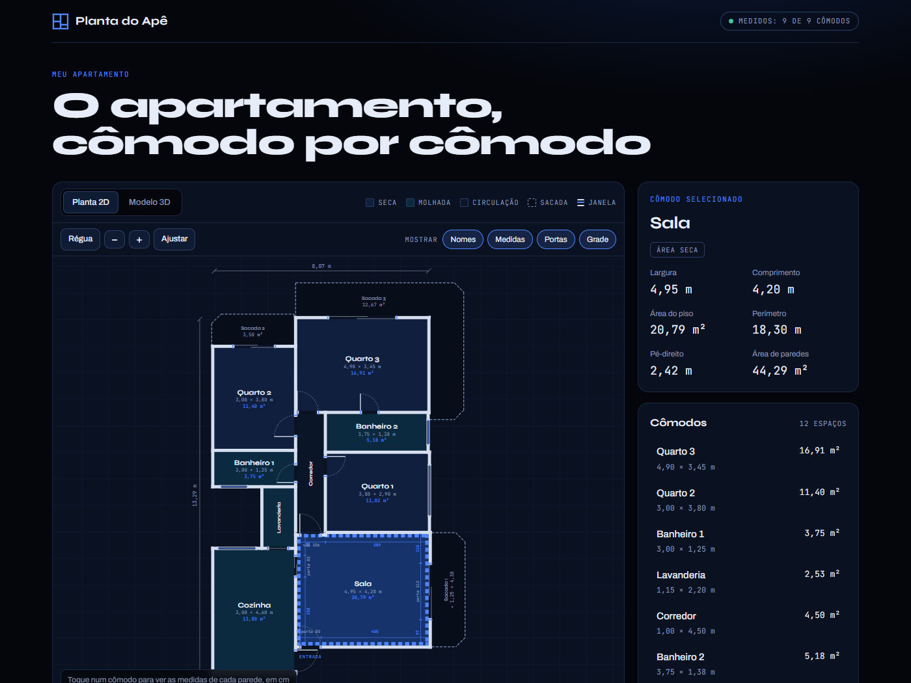
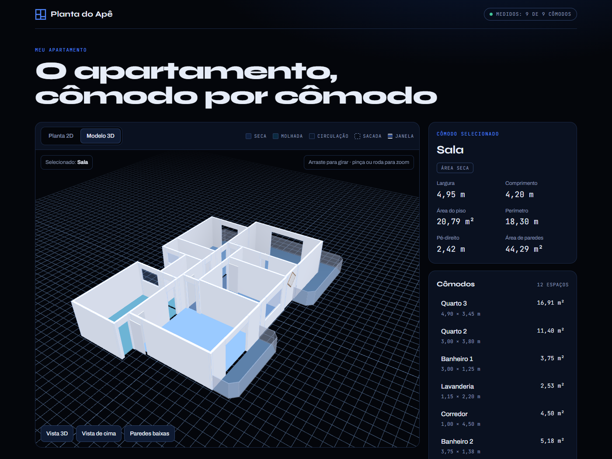
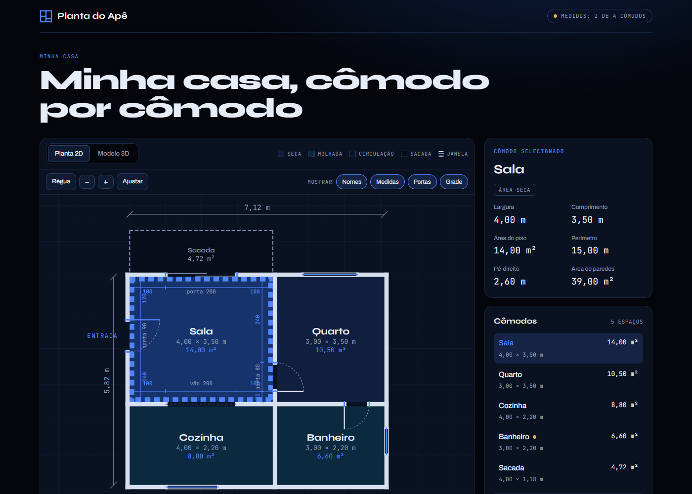

<div align="center">

# 🏠 Roomprint

**Transforme as medidas da sua casa numa planta baixa interativa e num modelo 3D, direto no navegador.**

Um projeto pessoal construído **inteiramente com IA**: eu dirigi as ideias, as medidas e as decisões, e a IA escreveu o código.
Comecei com o meu apartamento e deixei tudo pronto para **qualquer pessoa desenhar a própria casa**.


### [🔗 Ver ao vivo: planta-do-ape.web.app](https://planta-do-ape.web.app)

<sub>O site ao vivo mostra o meu apartamento. Clonando o repositório, você começa com uma casa de exemplo pronta para virar a sua.</sub>

</div>

---





## Sumário

- [O que dá pra fazer](#-o-que-dá-pra-fazer)
- [Feito com IA](#-feito-com-ia)
- [Faça a planta da sua casa](#-faça-a-planta-da-sua-casa)
  - [Planta por fotos (com IA)](#planta-por-fotos-com-ia)
  - [1. Baixe e rode o projeto](#1-baixe-e-rode-o-projeto)
  - [2. Meça a casa](#2-meça-a-casa)
  - [3. Entenda as coordenadas](#3-entenda-as-coordenadas)
  - [4. Comece pela casa de exemplo](#4-comece-pela-casa-de-exemplo)
  - [5. Cômodos](#5-cômodos)
  - [6. Portas](#6-portas)
  - [7. Janelas](#7-janelas)
  - [8. Sacadas e formas livres](#8-sacadas-e-formas-livres)
  - [9. Casas com mais de um andar](#9-casas-com-mais-de-um-andar)
  - [10. Publique](#10-publique)
  - [Dicas e erros comuns](#dicas-e-erros-comuns)
  - [Referência de campos](#referência-de-campos)
- [Tecnologias e arquitetura](#-tecnologias-e-arquitetura)
- [Licença](#-licença)

## ✨ O que dá pra fazer

- **Planta 2D interativa em SVG**: zoom (roda do mouse, botões ou pinça no celular), arrastar e enquadrar.
- **Clique num cômodo** para ver largura, comprimento, área do piso, perímetro, pé-direito e área de paredes.
- **Medida de cada parede**, em cm, com portas, vãos e janelas descontados.
- **Régua** para medir a distância entre dois pontos quaisquer.
- **Coordenadas sob o cursor**, que ajudam a posicionar portas e janelas na hora de montar a sua planta.
- **Camadas** liga/desliga: nomes, cotas, portas e grade.
- **Baixar PNG**: exporta a planta inteira como imagem em alta resolução, respeitando as camadas ligadas.
- **Imprimir em escala** (1:50, 1:75, 1:100…) em A4 ou A3, em fundo branco, com carimbo e barra de escala; a escala automática escolhe a maior que cabe na folha. Para gerar PDF, use "Salvar como PDF".
- **Modelo 3D** gerado dos mesmos dados: paredes, portas abertas, janelas com vidro, sacadas com guarda-corpo, vista de cima e os modos "paredes baixas" e "ocultar portas". O three.js só é baixado quando uma aba 3D é aberta, então a página abre mais rápido.
- **Caminhar**: passeio em primeira pessoa pela casa (WASD/setas, arrastar para olhar, botões na tela no celular), com colisão nas paredes e o cômodo atual destacado no painel.
- **Editor visual**: monte a planta arrastando cômodos (as bordas grudam na distância certa da parede), redimensione pelas alças, clique numa parede para pôr portas e janelas, desfaça/refaça e baixe o `apartamento.js` pronto. O editor avisa (e marca em vermelho) cômodos que se sobrepõem ou ficaram sem espaço para a parede entre eles.
- **Planta por fotos (IA)**: envie de 1 a 5 fotos (dos cômodos, de uma planta impressa ou de um croqui) e o Claude monta a planta 2D e o 3D com as medidas estimadas. A planta gerada cai no Editor para você conferir e ajustar. Veja [como usar](#planta-por-fotos-com-ia).
- **Mensagens de erro claras** quando algum dado está errado, inclusive uma vírgula faltando.
- Funciona no **celular** e é acessível pelo **teclado**.

## 🤖 Feito com IA

Este projeto é um experimento sobre **até onde dá pra ir construindo software só conversando com uma IA**.

- Eu não escrevi o código à mão: descrevi o que queria, passei as medidas tiradas com trena e validei cada resultado.
- A IA (Claude) escreveu a geometria (paredes, recortes de portas e janelas, guarda-corpos), o desenho em SVG, a interação por toque e o modelo 3D.
- A organização em módulos e a transformação em ferramenta reutilizável também foram feitas com IA.

A ideia é mostrar o potencial da IA como parceira de desenvolvimento: dá pra sair de um rascunho no papel e chegar numa aplicação organizada, funcional e que outras pessoas podem usar.

---

## 📐 Faça a planta da sua casa

Você só vai editar **um arquivo**: [`public/js/constants/apartamento.js`](public/js/constants/apartamento.js). A planta 2D, o modelo 3D, as áreas e a lista de cômodos são gerados automaticamente a partir dele.

> ✨ **Atalho: use o Editor.** Na aba **Editor** do site dá para montar a planta com o mouse, sem fazer as contas de coordenadas à mão. Quando terminar, clique em **Baixar apartamento.js** e substitua o arquivo em `public/js/constants/`. O guia abaixo continua útil para entender o formato e fazer ajustes finos.

### Planta por fotos (com IA)

O jeito mais rápido de começar: clique em **Planta por fotos (IA)**, no topo da página.

1. Escolha de **1 a 5 fotos**. O melhor resultado vem de uma foto da planta do imóvel (do contrato, do folheto da construtora) ou de um croqui à mão **com as medidas escritas**. Com fotos dos cômodos, a IA estima as medidas pelas referências (portas, pisos, camas, bancadas).
2. Se quiser, escreva **dicas**, como "a sala tem 4 m de largura" ou "o banheiro fica entre os quartos". Elas valem mais que as estimativas.
3. Cole a sua **chave da API da Anthropic** ([crie uma aqui](https://console.anthropic.com/settings/keys)) e clique em **Gerar planta**. Leva de 1 a 3 minutos.
4. A planta aparece nas abas 2D, 3D e Caminhar e entra no **Editor** como uma alteração comum: dá para ajustar, desfazer e **baixar o `apartamento.js`**.

Bom saber:

- **As medidas são estimativas.** Cada cômodo ganha uma nota com a confiança da IA (alta, média ou baixa) e de onde a medida saiu. Confira com uma trena e marque `medido: true` depois.
- **Casas com mais de um andar:** mande as plantas de cada pavimento e a IA monta os andares alinhados. A escada vem marcada como um cômodo de circulação; desenhe-a depois com **+ Escada**, no Editor. Também dá para gerar um andar de cada vez: escolha em "Onde colocar a planta gerada" entre substituir o andar visível ou criar um andar novo acima ou abaixo.
- **A chave é sua e fica no seu navegador.** O site é estático (não tem servidor), então o pedido vai direto do navegador para a API da Anthropic. Ela só é guardada se você marcar "Lembrar neste navegador" (em `localStorage`); não marque em computador compartilhado.
- **Custo:** cada geração é cobrada na sua conta da API, conforme o tamanho das fotos e a quantidade de raciocínio. Costuma ser bem menos de US$ 1.
- Por dentro: modelo `claude-opus-5-5`, resposta em JSON garantida por esquema ([`domain/planta-ia.js`](public/js/domain/planta-ia.js)), fotos reduzidas para 2000 px no navegador antes do envio. Os ajustes ficam em [`constants/ia.js`](public/js/constants/ia.js).

### 1. Baixe e rode o projeto

Você precisa do [Node.js](https://nodejs.org/) instalado (só para rodar um servidor local).

```bash
git clone https://github.com/porcherm/planta-casa.git
cd planta-casa
npm run dev
```

Abra **http://localhost:5000**. A cada alteração no arquivo de dados, é só salvar e recarregar a página (F5).

> ⚠️ Abrir o `index.html` com dois cliques **não funciona**, porque o navegador bloqueia módulos JavaScript fora de um servidor. Use sempre o `npm run dev`.

### 2. Meça a casa

Com uma trena, anote para cada cômodo:

- **largura** (esquerda → direita) e **comprimento** (cima → baixo), **de parede a parede, por dentro**;
- a **espessura das paredes** internas (normalmente entre 12 e 15 cm; meça no batente de uma porta);
- a posição e a largura de cada **porta** e **janela**;
- o **pé-direito** (altura do chão ao teto).

Antes de passar para o computador, faça um **rascunho no papel** com os cômodos na posição certa. Isso ajuda muito.

### 3. Entenda as coordenadas

A planta é como uma folha quadriculada onde **1 unidade = 1 cm**:

```
 (0,0) ──────────► x  (cresce para a direita)
   │
   │    ┌──────────┐
   │    │  cômodo  │   x, y = canto de cima à esquerda
   │    └──────────┘
   ▼
   y  (cresce para BAIXO)
```

Três regras resolvem quase tudo:

| Regra | Exemplo (parede de 12 cm) |
|---|---|
| **Cômodo vizinho à direita**: `x` = `x` do anterior + `largura` + `parede` | `0 + 400 + 12 = 412` |
| **Cômodo vizinho abaixo**: `y` = `y` do anterior + `comprimento` + `parede` | `0 + 350 + 12 = 362` |
| **Portas e janelas ficam no meio da parede** (no eixo): borda do cômodo + `parede / 2` | `400 + 6 = 406` |

> 💡 **Dica:** com o site aberto, **passe o mouse sobre a planta**. O canto superior direito mostra as coordenadas `x` e `y` do ponto. Use isso para descobrir onde colocar uma porta ou janela.

### 4. Comece pela casa de exemplo

Ao clonar o repositório, o [`apartamento.js`](public/js/constants/apartamento.js) já vem com uma **casa de exemplo** bem simples, comentada linha a linha. É ela que aparece ao rodar `npm run dev`:



1. Abra `public/js/constants/apartamento.js` e leia os comentários junto com a imagem acima.
2. Vá trocando cômodo por cômodo pelas medidas da sua casa, salvando e recarregando a página a cada passo.
3. Se bagunçar tudo, há uma cópia intacta do exemplo em [`exemplos/casa-simples.js`](public/js/constants/exemplos/casa-simples.js) para recomeçar.

> 🔎 Quer ver um caso real e mais complexo, com corredor, sacadas em formato livre e janela em losango? Os dados do meu apartamento (o do site ao vivo) estão no ramo [`meu-apartamento`](https://github.com/porcherm/planta-casa/blob/meu-apartamento/public/js/constants/apartamento.js).

No topo do arquivo ficam as informações gerais:

```js
export const APARTAMENTO = {
  nome: 'Casa da Maria',                      // aparece acima do título
  titulo: 'Minha casa, cômodo por cômodo',    // título grande da página
  estado: 'real',                             // 'real', 'rascunho' ou 'exemplo'
  comodoInicial: 'sala',                      // id do cômodo já selecionado ao abrir
  peDireito: 260,                             // altura do teto (cm)
  parede: 12,                                 // espessura das paredes internas (cm)
  alturaPorta: 210,                           // altura das portas (cm)
  comodos: [ /* ... */ ],
  portas: [ /* ... */ ],
  janelas: [ /* ... */ ],
};
```

### 5. Cômodos

Cada cômodo retangular é uma linha:

```js
{ id: 'sala', nome: 'Sala', tipo: 'interno', medido: true, x: 0, y: 0, largura: 400, comprimento: 350 },
{ id: 'quarto', nome: 'Quarto', tipo: 'interno', medido: true, x: 412, y: 0, largura: 300, comprimento: 350 },
```

- `id`: um nome curto, sem espaços e sem acento (usado internamente).
- `tipo`: define a cor e o comportamento. `interno` (padrão: sala, quartos, cozinha, banheiro…), `circulacao` (corredores), `sacada` ou `indefinido` (ainda não sabe). Os nomes antigos `seco` e `molhado` continuam aceitos e viram `interno`.
- `medido: true`: marca que você mediu com trena. O selo no topo da página mostra quantos cômodos já foram medidos.
- `nota` (opcional): um aviso que aparece ao selecionar o cômodo, por exemplo `nota: 'Confirmar a largura'`.

As paredes são **desenhadas automaticamente** em volta de cada cômodo; você não precisa declará-las.

### 6. Portas

A porta é um segmento **no eixo da parede**, de `(x1, y1)` até `(x2, y2)`. Ela precisa ser reta: horizontal (mesmo `y`) ou vertical (mesmo `x`).

```js
// Porta vertical na parede entre Sala e Quarto (eixo em x = 406), com 80 cm de largura
{ nome: 'Quarto', tipo: 'porta', x1: 406, y1: 240, x2: 406, y2: 320, lado: 1, dobradica: 'fim' },
```

| `tipo` | O que é |
|---|---|
| `porta` | porta comum, de abrir |
| `entrada` | porta de entrada (destacada em azul, com o texto "ENTRADA") |
| `correr` | porta de correr |
| `vao` | passagem aberta, sem porta |

Para portas de abrir (`porta` e `entrada`):

- `lado` indica **para onde a porta abre**: numa porta vertical, `1` = direita e `-1` = esquerda; numa porta horizontal, `1` = para baixo e `-1` = para cima.
- `dobradica` indica **em qual ponta fica a dobradiça**: `'inicio'` = no ponto `(x1, y1)`, `'fim'` = no ponto `(x2, y2)`.

Errou o lado? Troque `1` por `-1` e recarregue. É mais rápido testar do que pensar 😉

### 7. Janelas

Igual às portas (segmento no eixo da parede), mais as alturas:

```js
{ nome: 'Janela da Cozinha', x1: 100, y1: 588, x2: 250, y2: 588, peitoril: 110, topo: 210 },
```

- `peitoril`: altura do chão até a base da janela (cm).
- `topo`: altura do chão até o topo da janela (cm).
- `forma: 'losango'` (opcional): janela quadrada girada 45°, comum em banheiros.

### 8. Sacadas e formas livres

Para formatos que não são retângulos, use `pontos`: a lista dos cantos em ordem, como se você contornasse o cômodo com o dedo.

```js
{ id: 'sacada', nome: 'Sacada', tipo: 'sacada', pontos: [[0, -12], [400, -12], [400, -130], [0, -130]] },
```

- Cômodos do tipo `sacada` não ganham paredes: ganham **guarda-corpo** (a linha tracejada), exceto no lado que encosta na casa.
- Para encostar a sacada na casa, use a **face de fora da parede**: borda do cômodo + `parede` inteira. No exemplo, a parede de cima da sala fica em `y = -6` (eixo) e a face de fora em `y = -12`.
- Se o nome ficar em lugar ruim, ajuste a posição com `rotulo: [x, y]`.

### 9. Casas com mais de um andar

Sobrado, casa com subsolo ou com mais pavimentos: troque `comodos`, `portas` e `janelas` por uma lista de `andares`, **de baixo para cima**. Cada andar segue exatamente as mesmas regras de uma planta de um andar só. O exemplo completo está em [`exemplos/sobrado.js`](public/js/constants/exemplos/sobrado.js).

```js
export const APARTAMENTO = {
  nome: 'Meu sobrado',
  peDireito: 270,
  parede: 15,
  andares: [
    { id: 'subsolo', nome: 'Subsolo', peDireito: 250, comodos: [ /* ... */ ], portas: [ /* ... */ ] },
    { id: 'terreo', nome: 'Térreo', referencia: true, comodos: [ /* ... */ ], portas: [ /* ... */ ], janelas: [ /* ... */ ] },
    { id: 'superior', nome: 'Superior', comodos: [ /* ... */ ] },
  ],
};
```

- **Mesmas coordenadas em todos os andares**: o ponto (0, 0) do térreo fica exatamente embaixo do (0, 0) do superior. Assim as paredes de um andar caem em cima das do outro. Na planta 2D, ligue **Mostrar → Andar de baixo** para ver as paredes do andar de baixo tracejadas e alinhar.
- **`referencia: true`** marca o andar que fica no nível da rua (cota 0). Sem ele, vale o andar com `id: 'terreo'` (ou o primeiro).
- **A altura de cada andar é calculada**: acima da referência, soma o pé-direito do andar de baixo e a laje; abaixo, desconta. No exemplo, o superior fica a +2,85 m (270 + 15) e o subsolo a −2,65 m (15 + 250). Para casas com meio-nível, informe a altura do piso em `cota` (cm).
- **`peDireito` e `laje`** (espessura da laje embaixo do andar) são opcionais em cada andar.
- Os `id` dos cômodos precisam ser diferentes em toda a casa, não só no andar.

No site:
- O seletor **Andar** aparece acima da planta em todas as abas; **Page Up** e **Page Down** sobem e descem.
- No **Editor**, os botões **+ Acima** e **+ Abaixo** criam um andar já com o contorno do andar de onde você partiu, e **Ajustes** muda nome, pé-direito, laje e altura do andar.
- No **Modelo 3D**, **Só até este andar** corta a casa para ver o andar por dentro, e **Ocultar terreno** mostra o subsolo.
- Ao **imprimir**, escolha "Todos os andares": sai uma folha por andar, todas na mesma escala e na mesma posição, para dar para sobrepor.

#### Escadas

Cada escada liga um andar ao andar logo acima e fica na lista `escadas` da casa:

```js
escadas: [
  { id: 'escada-hall', nome: 'Escada do hall', tipo: 'U', de: 'terreo', para: 'superior',
    x: 665, y: 225, largura: 200, comprimento: 286, sobe: 'norte', giro: 'direita', lance: 90 },
],
```

- `x`, `y`, `largura` e `comprimento` são o retângulo que a escada ocupa na planta, nas mesmas coordenadas dos cômodos. Ela precisa ficar dentro de um cômodo nos dois andares.
- `sobe` diz para que lado se sobe: `'norte'` (para cima da planta), `'sul'`, `'leste'` ou `'oeste'`.
- `tipo`: `'reta'`, `'L'` (dois lances com patamar no canto), `'U'` (dois lances lado a lado, com patamar no fundo) ou `'caracol'`. Em L, U e caracol, `giro` diz para que lado ela vira; em L e U, `lance` é a largura de cada lance; na caracol, `volta` é quanto ela gira (padrão 360°).
- **Os degraus são calculados sozinhos** pela altura entre os andares (~17,5 cm cada). O editor mostra quantos degraus ficaram, a altura de cada um, o piso e a fórmula de Blondel (2 × espelho + piso), e avisa se a escada ficou desconfortável, estreita ou fora dos cômodos.
- Na planta, o andar de baixo mostra **SOBE**, com os degraus acima do plano de corte tracejados; o de cima mostra **DESCE**, o buraco na laje e o guarda-corpo.
- No **Editor**, **+ Escada** cria uma escada do andar visível para o de cima. Arraste para posicionar, escolha o tipo e o sentido no painel e use **Girar 90°**.
- No **Caminhar**, é só andar até a escada e subir: a altura acompanha os degraus. Os botões **Subir/Descer andar** continuam lá como atalho.

#### Pé-direito duplo e mezanino (vazios)

Um **vazio** é um recorte no piso de um andar: ali não há laje, e o cômodo de baixo fica com pé-direito duplo. Ele fica na lista `vazios` do andar onde está o recorte (o de cima), como um retângulo ou com `pontos`:

```js
{ id: 'mezanino', nome: 'Mezanino', peDireito: 240, comodos: [ /* ... */ ],
  vazios: [{ id: 'vazio-sala', nome: 'Vazio da sala', x: 0, y: 320, largura: 600, comprimento: 300 }] },
```

O vazio precisa ficar dentro de um cômodo desse andar (num mezanino, o próprio mezanino). Em volta dele entra um guarda-corpo, na planta e no 3D; o painel mostra o pé-direito duplo do cômodo de baixo. No **Editor**, use **+ Vazio**. Exemplo completo: [`exemplos/casa-mezanino.js`](public/js/constants/exemplos/casa-mezanino.js).

#### Terreno em desnível e telhado

Os dois ficam no nível da casa e aparecem no **Modelo 3D** e no **Corte**:

```js
terreno: { desce: 'sul', desnivel: 265 },                        // na frente, nível da rua; nos fundos, 2,65 m abaixo
telhado: { tipo: 'quatro-aguas', inclinacao: 30, beiral: 50 },  // 'laje', 'duas-aguas' ou 'quatro-aguas'
```

- O terreno cai em linha reta de um lado da casa ao outro (`desce`: `'norte'`, `'sul'`, `'leste'` ou `'oeste'`). É o caso clássico de garagem no subsolo abrindo para os fundos.
- O telhado cobre o retângulo do último andar. Laje vem com platibanda; duas e quatro águas usam a `inclinacao` (em %) e o `beiral` (em cm). No 3D ele começa escondido, para dar para ver por dentro: use **Mostrar telhado**.
- No **Editor**, os dois ficam em **Ajustes** (com nada selecionado), em "Terreno e telhado".

#### Corte

A aba **Corte** desenha a casa cortada por uma linha, como no desenho técnico: lajes e paredes cortadas em petróleo, portas e janelas (com verga, peitoril e vidro), degraus, guarda-corpos, o terreno com hachura, o telhado e o nível de cada andar com o pé-direito. Escolha **AA** (linha horizontal) ou **BB** (vertical), mova a linha com **Posição** ou clicando no mapa do canto, e baixe como PNG.

### 10. Publique

O projeto já vem configurado para o **Firebase Hosting** (gratuito):

```bash
npm install -g firebase-tools
firebase login
firebase use --add        # escolha um projeto criado em console.firebase.google.com
npm run deploy
```

No fim, o terminal mostra o link do seu site (algo como `https://seu-projeto.web.app`).

> Como é um site estático, também funciona na **Netlify** ou na **Vercel**: é só indicar `public/` como pasta de publicação.

### Dicas e erros comuns

- **A página mostra "Erro nos dados da planta"**: leia a mensagem, porque ela diz qual cômodo e qual campo estão errados. Se o erro for "de escrita", procure uma **vírgula**, **chave `{ }`** ou **colchete `[ ]`** faltando perto da linha que você editou por último.
- **A porta aparece, mas a parede não abriu no lugar dela**: a porta não está exatamente no eixo da parede. Confira a conta `borda + parede / 2`.
- **Dois cômodos estão grudados, sem parede entre eles**: faltou somar a `parede` no `x` ou no `y` do segundo cômodo.
- **Cômodo em formato de L**: use `pontos`, ou divida em dois retângulos.
- **Meça duas vezes**: a régua do site ajuda a conferir se as medidas fecham.

### Referência de campos

<details>
<summary><b>Geral</b></summary>

| Campo | Obrigatório | Padrão | Descrição |
|---|---|---|---|
| `nome` | não | `'Minha casa'` | Nome exibido acima do título e na aba do navegador |
| `titulo` | não | `'Minha casa, cômodo por cômodo'` | Título grande da página |
| `estado` | não | `'real'` | `'real'`, `'rascunho'` ou `'exemplo'` (texto do selo no topo) |
| `comodoInicial` | não | primeiro cômodo | `id` do cômodo selecionado ao abrir |
| `peDireito` | não | `260` | Altura do teto, em cm |
| `parede` | não | `0` | Espessura das paredes internas, em cm |
| `alturaPorta` | não | `210` | Altura das portas, em cm |
| `comodos` | **sim**, se não usar `andares` | | Lista de cômodos (pelo menos um) |
| `portas` | não | `[]` | Lista de portas |
| `janelas` | não | `[]` | Lista de janelas |
| `andares` | não | | Casa com mais de um andar: lista de andares, de baixo para cima (no lugar de `comodos`, `portas` e `janelas`) |

</details>

<details>
<summary><b>Andar</b> (dentro de <code>andares</code>)</summary>

| Campo | Obrigatório | Padrão | Descrição |
|---|---|---|---|
| `comodos` | **sim** | | Cômodos do andar (pelo menos um) |
| `portas`, `janelas` | não | `[]` | Portas e janelas do andar |
| `id` | não | gerado | Identificador sem espaços |
| `nome` | não | `'Andar N'` | Nome exibido no seletor, no painel e na impressão |
| `referencia` | não | | `true` no andar que fica no nível da rua (cota 0) |
| `peDireito` | não | o da casa | Pé-direito deste andar, em cm |
| `laje` | não | `15` | Espessura da laje embaixo deste andar, em cm |
| `cota` | não | calculada | Altura do piso em relação à rua, em cm (só para meio-nível) |
| `vazios` | não | `[]` | Recortes no piso deste andar (pé-direito duplo): `x`, `y`, `largura`, `comprimento` ou `pontos` |

</details>

<details>
<summary><b>Terreno e telhado</b> (no nível da casa)</summary>

| Campo | Padrão | Descrição |
|---|---|---|
| `terreno.desce` | plano | Para onde o terreno desce: `'norte'`, `'sul'`, `'leste'` ou `'oeste'` |
| `terreno.desnivel` | | Quanto ele desce de um lado da casa ao outro, em cm |
| `telhado.tipo` | `'nenhum'` | `'laje'`, `'duas-aguas'` ou `'quatro-aguas'` |
| `telhado.inclinacao` | `30` | Inclinação dos panos, em % |
| `telhado.beiral` | `50` | Quanto o telhado passa das paredes, em cm |

</details>

<details>
<summary><b>Escada</b> (dentro de <code>escadas</code>)</summary>

| Campo | Obrigatório | Padrão | Descrição |
|---|---|---|---|
| `de`, `para` | **sim** | | `id` do andar onde ela começa e do andar logo acima |
| `x`, `y`, `largura`, `comprimento` | **sim** | | Retângulo que ela ocupa na planta, em cm |
| `tipo` | não | `'reta'` | `'reta'`, `'L'`, `'U'` ou `'caracol'` |
| `sobe` | não | `'norte'` | Para que lado se sobe: `'norte'`, `'sul'`, `'leste'` ou `'oeste'` |
| `giro` | não | `'direita'` | Em L, U e caracol: para que lado ela vira |
| `lance` | não | `90` | Em L e U: largura de cada lance, em cm |
| `volta` | não | `360` | Na caracol: quanto ela gira, em graus |
| `id`, `nome` | não | gerados | Identificador e nome exibido |

</details>

<details>
<summary><b>Cômodo</b></summary>

| Campo | Obrigatório | Descrição |
|---|---|---|
| `nome` | **sim** | Nome exibido |
| `id` | não | Identificador sem espaços (gerado se faltar) |
| `tipo` | não | `interno` (padrão), `circulacao`, `sacada` ou `indefinido` |
| `x`, `y`, `largura`, `comprimento` | **sim**, se não usar `pontos` | Retângulo, em cm |
| `pontos` | **sim**, se não usar o retângulo | Lista de cantos `[x, y]` (mínimo 3) |
| `medido` | não | `true` se foi medido com trena |
| `nota` | não | Aviso exibido no painel |
| `rotulo` | não | Posição `[x, y]` do nome na planta |

</details>

<details>
<summary><b>Porta</b></summary>

| Campo | Obrigatório | Descrição |
|---|---|---|
| `x1`, `y1`, `x2`, `y2` | **sim** | Pontas da porta, no eixo da parede |
| `tipo` | não | `porta` (padrão), `entrada`, `correr` ou `vao` |
| `lado` | não | `1` ou `-1`: para onde a folha abre (sem ele, a folha não é desenhada) |
| `dobradica` | não | `'inicio'` (padrão) ou `'fim'` |
| `nome` | não | Descrição, só para você se organizar |

</details>

<details>
<summary><b>Janela</b></summary>

| Campo | Obrigatório | Padrão | Descrição |
|---|---|---|---|
| `x1`, `y1`, `x2`, `y2` | **sim** | | Pontas da janela, no eixo da parede |
| `peitoril` | não | `100` | Altura da base da janela, em cm |
| `topo` | não | `210` | Altura do topo da janela, em cm |
| `forma` | não | | `'losango'` para janela girada 45° |
| `nome` | não | | Descrição |

</details>

---

## 🧱 Tecnologias e arquitetura

- **HTML + CSS + JavaScript puro** com ES Modules nativos, **sem build** e sem framework.
- **SVG** para a planta 2D e **[three.js](https://threejs.org/)** (via CDN) para o modelo 3D.
- **Firebase Hosting** para publicar.

```
planta-casa/
├── public/                     # tudo o que vai para o site
│   ├── index.html              # página inicial (apresentação, catálogo, como funciona)
│   ├── app.html                # o app: planta 2D, 3D, Caminhar e Editor (abre a aba pelo #2d, #3d, #caminhar, #editor)
│   ├── assets/                 # favicon e a planta exportada em SVG (Inkscape/Figma)
│   ├── css/
│   │   ├── base.css            # design tokens (cores, fontes) e reset
│   │   ├── layout.css          # estrutura da página
│   │   ├── components.css      # botões, cards, lista, legenda…
│   │   └── planta.css          # estilos do SVG da planta e do 3D
│   └── js/
│       ├── main.js             # ponto de entrada: carrega os dados e monta tudo
│       ├── constants/
│       │   ├── apartamento.js  # ✏️ os dados da casa (o único arquivo que você edita)
│       │   ├── exemplos/       # casa de exemplo para começar
│       │   ├── tipos.js        # tipos de cômodo e de porta
│       │   └── visualizacao.js # ajustes de zoom e visual
│       ├── context/            # estado compartilhado (dados da casa e cômodo selecionado)
│       ├── domain/             # regras puras: validação, geometria e colisão
│       ├── components/
│       │   ├── planta2d/       # desenho SVG, zoom/arrasto, gestos de toque, exportar PNG
│       │   ├── modelo3d/       # cena three.js e construção do modelo
│       │   ├── passeio/        # aba Caminhar: primeira pessoa com colisão
│       │   ├── editor/         # aba Editor: operações, formulário e exportação
│       │   ├── fotos-ia/       # "Planta por fotos": envio das fotos, chamada à IA e resultado
│       │   ├── painel.js       # detalhes + lista de cômodos
│       │   ├── cabecalho.js
│       │   ├── abas.js         # alterna entre 2D, 3D, Caminhar e Editor
│       │   └── erro.js         # mostra erros nos dados
│       └── utils/              # formatação, DOM e helpers de SVG
├── docs/                       # imagens do README
└── firebase.json
```

**Decisões de arquitetura**

- **Dados separados da apresentação**: a casa inteira é descrita num único arquivo, e tudo o que aparece na tela é gerado a partir dele.
- **Domínio puro**: [`domain/`](public/js/domain) não toca no DOM nem no three.js, então dá pra testar com Node.
- **Estado único**: [`context/store.js`](public/js/context/store.js) guarda o cômodo selecionado; os componentes se inscrevem nele e não conversam entre si.
- **Paredes calculadas**: as paredes saem do contorno dos cômodos, os trechos sobrepostos são unidos e os vãos de portas e janelas são recortados automaticamente.
- **3D sob demanda**: a cena só é criada quando a aba 3D é aberta, e o loop de renderização para quando ela fica escondida.

## 📄 Licença

[MIT](LICENSE): use, modifique e compartilhe à vontade. Se fizer a planta da sua casa, vou adorar ver! ⭐
